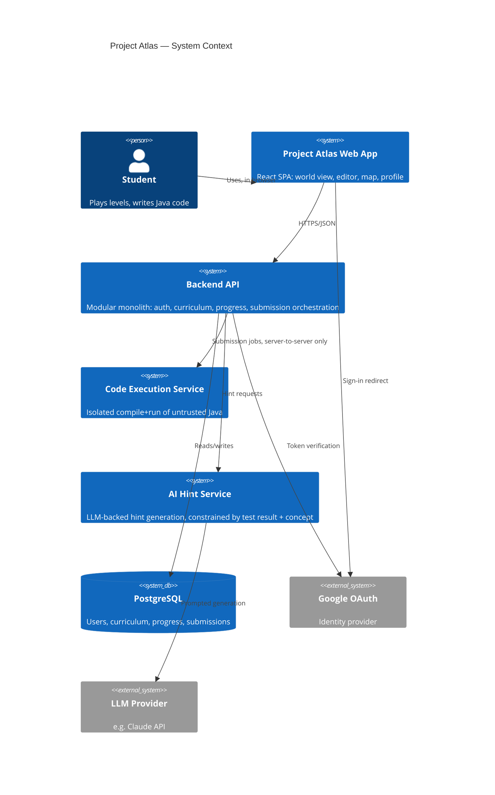
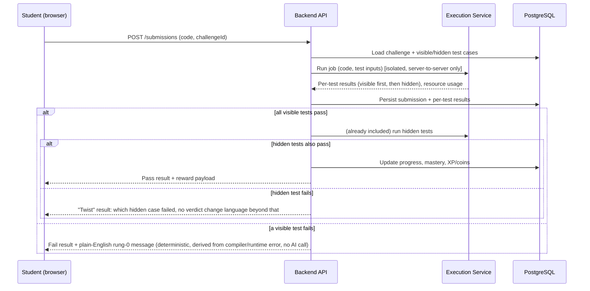
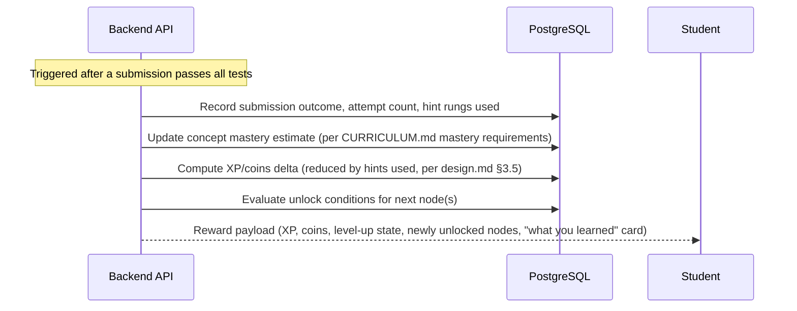

# System Architecture — Project Atlas

This describes the **proposed** architecture for implementation, not anything currently built — see [README.md](README.md) implementation status. Technology choices referenced here are detailed and justified in [TECH.md](TECH.md); this document covers how the pieces fit together.

## 1. System context



**Key boundary:** the browser never talks to the Code Execution Service or the AI Hint Service directly — everything routes through the backend API, which owns authorization and rate limiting (see [SECURITY.md](SECURITY.md)).

## 2. Components and responsibilities

- **Web App (frontend):** renders world view, editor, map, HUD, profile; drives the step/run/scrub timeline; never contains hidden test cases or answer keys (fetches only what [API_SPEC.md](API_SPEC.md) defines as public).
- **Backend API (modular monolith, [DECISIONS.md#d9](DECISIONS.md)):** auth session handling, curriculum/content retrieval, submission orchestration (queues a job to the execution service and polls/streams the result), progress and mastery updates, reward calculation, hint-request proxying (with rate limiting) to the AI service. Organized as internal modules (`auth`, `curriculum`, `submissions`, `progress`, `hints`) within one deployable, not as separate network services — module boundaries are a code-organization device, not a deployment one, until a measured need says otherwise.
- **Code Execution Service:** a separately deployed, network-isolated service. Receives (source code, challenge's test inputs), compiles, runs under strict resource limits, returns structured results (per-test pass/fail, stdout/stderr, resource usage, or a timeout/error classification). Implementation (managed vs. self-hosted) is TBD per [TECH.md](TECH.md) §9.
- **AI Hint Service:** receives (submitted code, failing test result, level's concept metadata, current hint rung) and returns a natural-language hint appropriate to that rung. Never receives or returns a pass/fail verdict — that always comes from the Code Execution Service's test results.
- **PostgreSQL:** single relational store — see [DATABASE.md](DATABASE.md).
- **Google OAuth:** external identity provider for sign-in.

## 3. Data flow: code submission and evaluation



Visible and hidden tests are both executed by the Code Execution Service in the same job (to avoid a second network round trip and so the student can't infer hidden cases by timing); the API controls what's revealed to the client and when, per `design.md` §2 and §7.

## 4. Data flow: AI hint generation

```mermaid
sequenceDiagram
    participant U as Student
    participant API as Backend API
    participant AI as AI Hint Service
    participant LLM as LLM Provider

    U->>API: POST /hints (submissionId, requestedRung)
    API->>API: Check rung eligibility (rung 1+ only after a failed run; rung 4 only after 3+ attempts) + per-user daily rate limit
    API->>AI: (code, failing test result, level concept, rung)
    AI->>LLM: Prompt — code/test data marked as untrusted content, not instructions
    LLM-->>AI: Hint text
    AI-->>API: Hint text (rung-appropriate)
    API-->>U: Hint text + rung number (level marked "assisted" if rung 4 used)
```

Rung 0 never reaches this flow — it's a deterministic lookup against an error-pattern table, resolved entirely in the Backend API with no AI call.

## 5. Data flow: user progress and reward



## 6. Authentication and authorization boundaries

- Guests may fetch and submit for level 1 only, with no persisted user record until they choose to sign up (per [PRD.md](PRD.md) F1) — enforced server-side by the API, not just hidden in the UI.
- All other endpoints require a valid session (see [API_SPEC.md](API_SPEC.md) for the auth scheme).
- Authorization is per-user ownership: a user can only read/write their own submissions and progress rows — every query scoped by `user_id` from the authenticated session, never from a client-supplied value (see [SECURITY.md](SECURITY.md) IDOR prevention).
- The Code Execution Service and AI Hint Service trust only the Backend API (internal network / service-to-service auth, e.g., a shared secret or mTLS — TBD, see [SECURITY.md](SECURITY.md)), never the public internet directly.

## 7. Progress tracking

Progress is derived from the `submissions` and `progress` tables ([DATABASE.md](DATABASE.md)) — level/node unlock state, concept mastery estimates, and XP/coin totals are all computed server-side after each submission, not trusted from client state. The client renders whatever the API returns; it never locally computes "you leveled up."

## 8. Error handling

- **Compile/runtime errors:** Execution Service returns a structured error classification (syntax error, runtime exception, timeout, resource-limit exceeded); API maps common classifications to the rung-0 plain-English table before falling back to a generic "your program didn't run as expected" message.
- **Execution Service unavailable/timeout:** API surfaces a clear "couldn't run your code, try again" state to the user — never silently treats a service failure as a failed test (that would misattribute a platform problem as the student's fault).
- **AI Hint Service failure:** degrade gracefully to the deterministic rung-0 message; hints are an enhancement, not a dependency for the core loop to function.

## 9. External service integrations

Google OAuth (identity), LLM provider (hints, see [TECH.md](TECH.md) §8), Code Execution Service (internal or managed, see [TECH.md](TECH.md) §9), error tracking / observability provider (TBD, see [docs/engineering/OBSERVABILITY.md](docs/engineering/OBSERVABILITY.md)).

## 10. Deployment topology

TBD pending hosting decision ([DECISIONS.md Q5](DECISIONS.md)); proposed shape: frontend as a static/CDN-deployed SPA, Backend API as a containerized service with autoscaling, Code Execution Service as a separately scaled worker pool/queue (so a spike in submissions doesn't starve the API), managed Postgres. Full detail in [docs/engineering/DEPLOYMENT.md](docs/engineering/DEPLOYMENT.md) once decided.

## 11. Scaling considerations

The Code Execution Service is the component most likely to need independent scaling (it's CPU/memory-bound per submission, and submission volume is spiky — a class of students all submitting around the same deadline). The Backend API and frontend are comparatively cheap to scale horizontally. Do not pre-build autoscaling infrastructure before real usage data from the validation cohort ([VALIDATION.md](VALIDATION.md)) justifies it — start with conservative fixed capacity and a queue that applies backpressure (clear "you're in a queue" UI state) rather than over-provisioning for unknown load.
